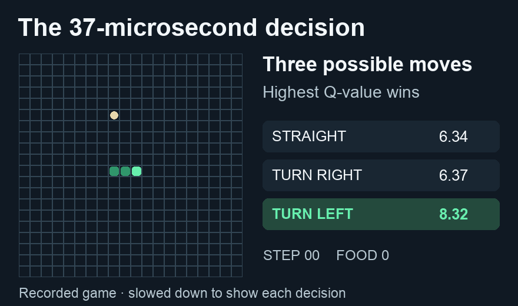

# Small Models Matter

An inspectable Deep Q-Network for Snake: **24 → 128 → 128 → 3**, with
**20,099 parameters** (78.5 KiB at FP32).

**[Open the interactive demo →](https://himal-dev.github.io/small-models-matter/)**

[](https://himal-dev.github.io/small-models-matter/)

The demo runs in your browser with no install. Pause the replay, select a
neuron to inspect its weights and bias, or toggle all **19,840 connections**.
The browser computes Q-values from the released checkpoint as it replays
recorded board states.

## Run locally

Use the local watcher to see weights change during training.

Use Python 3.9 or later with a supported PyTorch build.

```sh
python -m pip install -r requirements.txt
python src/neuron_watch.py --port 8765
```

Open <http://127.0.0.1:8765>. To train a new model while the watcher is open:

```sh
python src/snake_ai.py train --episodes 500
```

Use `--render` for the pygame window, or `python src/snake_ai.py play` to run
the best available checkpoint. New training outputs go to `data/run/`;
the shipped checkpoints and 500-episode history stay intact.

## Results

| Metric | Reference run |
|---|---:|
| Feature extraction + forward pass + argmax, median | 37.0 µs |
| Same path, p99 | 69.6 µs |
| Full loop including `game.step`, median | 61.2 µs |
| Training score, last 20 episodes (mean) | 25.4 |
| Best observed training score | 51 |
| Mean food per game, released policy / greedy rule | 36.56 / 26.38 |

Latency: Apple M3 Pro, PyTorch 2.8, one CPU thread, 20,000 samples per stage.
Rendering and I/O are outside the timed path. The policy comparison uses 100
seeded games per policy, separate from the training log.

```sh
python scripts/benchmark.py --json
python scripts/evaluate.py
python -m pip install -r requirements-dev.txt
python -m ruff check src scripts tests
python -m pytest -q
```

See [architecture](docs/architecture.md) and the
[benchmark protocol](docs/benchmarks.md).

## Static build

```sh
python scripts/build_pages.py
python -m http.server 8000 --bind 127.0.0.1 --directory dist
```

To publish, set the repository’s **Settings → Pages → Source** to
**GitHub Actions**. The deploy workflow builds `dist/` from the committed
model and data.

[MIT License](LICENSE)
